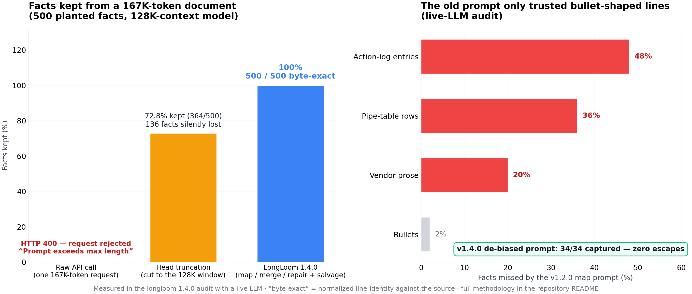

# LongLoom

**Weave documents of any length through LLM map/merge/repair — without losing a thread.**

[](https://pypi.org/project/longloom/)
[](https://pypi.org/project/longloom/)
[](https://github.com/sumitnemade/longloom/actions/workflows/ci.yml)
[](LICENSE)
[](longloom/py.typed)
[](https://sumitnemade.github.io/longloom/)
[](#test-it-yourself)
[](#we-tried-to-break-our-own-no-loss-claim)
[](#we-tried-to-break-our-own-no-loss-claim)

*Any LLM · Any storage · Measured no-loss · 2 core dependencies*

---

## Your context window is a hard wall. Your documents don't care.

A 128K-token model cannot read a 167K-token document. We measured what actually happens to the facts in that situation:

| Approach | Measured result (167K-token doc, 500 planted facts, live LLM) |
|---|---|
| Raw API call, one shot | **HTTP 400 — "Prompt exceeds max length".** The request never reaches the model. 0 facts. |
| Head truncation to fit the window | **72.8% kept** — 136 facts silently lost before the model says a word (and 64% lost on a 160K-token BRD). |
| DIY "chunk and summarize" script | The map prompt only trusts bullet-shaped lines: **pipe-table rows −36%, action-log entries −48%, prose −20%** missed. The merge stage drops more (measured **36–61%** silently dropped). |
| **LongLoom 1.4.0** | **500/500 facts byte-exact**, with the accounting to prove it in `result["coverage"]`. |



## We tried to break our own no-loss claim

Before asking you to trust "measured no-loss", we ran a hostile audit against our own library: planted-fact documents, a live LLM, byte-exact scoring (normalized line-identity against the source — not fuzzy similarity). The previous release, v1.2.0, failed it: the merge stage silently dropped **36% of 120** and **61% of 200** planted facts, and the map stage under-captured anything that didn't look like a bullet. Every failure below was fixed in **1.4.0** and re-measured on the published PyPI wheel:

| # | Claim in 1.4.0 | Verdict | Measured evidence |
|---|---|---|---|
| 1 | Coverage verification + deterministic salvage restores merge drops | **PASS** | Model dropped 43/120 → final **120/120 byte-exact**; second run dropped 123/200 → **200/200** (77 found + 123 salvaged) |
| 2 | No-loss beyond the context window | **PASS** | 167K-token doc (1.3× the 128K window): **500/500** byte-exact; 160,719-token BRD: **400/400** requirement needles + 10 headlines, recovered via audits at zero extra LLM cost |
| 3 | `source_audit` closes map-level escapes | **PASS** | Deterministic test: **17/17** escapes recovered verbatim, zero LLM calls |
| 4 | De-biased verbatim prompt captures non-bullet facts | **PASS** | Formats the old prompt missed at 36–48%: table rows **12/12**, action log **8/8**, prose **4/4**, bullets **10/10** — **34/34, zero escapes** |
| 5 | `numeric_audit` flags invented aggregates | **PASS** | Planted 9,999,999 aggregate flagged `unverifiable` (report-only), warning emitted |
| 6 | Rate-limit hardening | **PASS** | Jittered backoff observed live (6.5s → 14.6s → 30.0s); 429 storms survived via checkpoint resume |
| 7 | Shipped quality | **PASS** | Published wheel, fresh venv: **163 passed / 9 skipped / 0 failed**; 21/21 deterministic feature checks |

Full methodology, limitations, and the audit write-up: [docs / case study](https://sumitnemade.github.io/longloom/).

## Install

From [PyPI](https://pypi.org/project/longloom/) — the usual way:

```bash
pip install longloom                 # core: 2 dependencies only
pip install "longloom[all]"          # batteries included (all providers + databases)
pip install "longloom[tiktoken,nvidia]"   # pick exactly what you need
```

Extras: `[tiktoken]` `[nvidia]` `[openai]` `[postgres]` `[mysql]` `[mssql]` `[oracle]` `[mongodb]` `[supabase]` `[databases]` `[all]` `[dev]`

Python ≥ 3.10. **Tested with**: Python 3.10–3.13 · `langgraph` 1.2.x · `langchain-core` 1.7.x · NVIDIA Nemotron-3-Ultra and OpenAI GPT-4o-mini (real-API test suite).

## 60-second quickstart

```python
import os
from longloom import MapReduceProcessor, SQLiteContextStore, init_llm

processor = MapReduceProcessor(
    llm=init_llm("nvidia", "nvidia/nemotron-3-ultra-550b-a55b",
                 api_key=os.environ["NVIDIA_API_KEY"],   # your app owns the key
                 thinking=False),
    store=SQLiteContextStore("ctx.db"),
    max_chunk_tokens=3000,
    max_context_tokens=8192,          # your model's real window
)

result = processor.process(
    annual_report,                    # 50K tokens? 500K? doesn't matter
    task="Summarize the key findings",
)
print(result["final_result"])
print(f"{result['num_chunks']} chunks · {result['total_input_tokens']:,} tokens · "
      f"{result['repair_attempts']} repairs")
print(result["coverage"])             # fact accounting: verified / salvaged / method
```

Every run is **persisted and queryable** afterwards:

```python
processor.search_session(result["session_id"], "revenue")   # which chunks mention it
processor.retrieve_chunks(result["session_id"])              # original text, byte-faithful
processor.get_session_info(result["session_id"])             # chunk/token stats
```

## When facts must not be lost

Summarizing prompts measurably drop facts — and silently. When you need *everything*, switch to verbatim extraction:

```python
from longloom import PromptTemplates

processor = MapReduceProcessor(
    llm=llm,
    store=store,
    prompts=PromptTemplates.for_extraction(),   # verbatim line-copy mode
    ...
)

result = processor.process(doc, task="Extract every fact-bearing line")
print(result["source_audit"])    # map-level escapes, restored verbatim (zero LLM calls)
print(result["numeric_audit"])   # figures the model surfaced that the source can't verify
print(result["warnings"])        # report-only findings, never silently swallowed
```

**Measured result: 500/500 planted facts byte-exact on a 167K-token document (1.3× the window), and 320/320 across two live-LLM extraction runs — including 123 facts the merge model dropped and salvage restored verbatim.** The trade-off is output length: extraction copies, it doesn't compress. Summaries → `DEFAULT_PROMPTS`; completeness → `for_extraction()`.

## How it works

```text
              ┌───────────────┐
 big document ─► CHUNK + STORE ─► every byte persisted (SQLite / Postgres / Mongo / …)
              └───────┬───────┘
                      ▼   MAP      one LLM call per chunk — verbatim or summarizing
              ┌───────────────┐
              │  map results  │
              └───────┬───────┘
                      ▼   MERGE   window-sized hierarchical combine calls
              ┌───────────────┐           (scales past any single context window)
              │  merged draft │
              └───────┬───────┘
                      ▼   REPAIR  bounded condensation loop, only if still too big
              ┌───────────────┐
              │ final result  │  +  verification: every fact accounted for
              └───────┬───────┘
                      ▼   AUDIT    coverage salvage · source_audit · numeric_audit
              └───────────────┘
```

## What's new in 1.4.0

- **Coverage verification + deterministic salvage** — the final result is verified against the union of all map outputs; lines a merge model silently dropped are restored verbatim with **no extra LLM calls** (`result["coverage"]`).
- **`source_audit`** — re-checks the final output against the source chunks themselves, closing map-level escapes on messy, non-bullet documents (`result["source_audit"]`, opt-out with `source_audit=False`).
- **`numeric_audit`** — report-only check that flags multi-digit figures the model may have invented; surfaces in `result["numeric_audit"]` and `result["warnings"]`.
- **De-biased verbatim map prompt** — explicitly covers pipe-table rows, action/decision/meeting-log entries, and prose sentences ("a line does not need to look like a bullet to be a fact"). Measured: the old prompt's 36–48% format-dependent capture gap is now **zero**.
- **Merge self-verify + hardened retries** — Retry-After respected with a cap, jittered exponential backoff, and deterministic errors fail fast instead of burning retries.

## Built for production

| | |
|---|---|
| **Hierarchical merge** | Verbatim runs beyond one window still complete — merge calls are grouped and combined recursively (verified: a 45K-token extraction survives an 8K window). |
| **Retry + pacing** | Exponential backoff for 429/5xx/timeouts, optional min-interval between calls for long matrix runs. |
| **Bounded repair** | Oversized results condense with a capped attempt count — no infinite loops, no silent truncation. |
| **Token-count guardrails** | tiktoken exact or zero-dep estimator; chunk sizes clamped so map results are always combinable. |
| **Parallel map** | `max_workers=8` runs the map phase on a thread pool with shared rate-limit pacing — measured ≈4× on an 8-chunk document. |
| **Checkpoint/resume** | Map results are checkpointed per chunk; `resume=True` re-runs only what never completed after a crash. |
| **Observability** | `on_event=` emits structured events (per chunk, per LLM call with token usage, per repair, per audit) — forward to OTel/Datadog as you like. |
| **Retention & PII scrubbing** | `scrubber=` rewrites content before anything is stored; `delete_sessions_older_than(days)` sweeps old sessions across every backend. |
| **Conflict detection** | `detect_conflicts=True` runs an advisory pass that flags contradictory values side by side. |
| **Typed & versioned** | `py.typed`, semantic versioning, CHANGELOG, per-provider extras. |

## Any LLM

```python
init_llm("nvidia",    "nvidia/nemotron-3-ultra-550b-a55b", api_key=..., thinking=False)
init_llm("openai",    "gpt-4o-mini", api_key=os.environ["OPENAI_API_KEY"])
init_llm("anthropic", "claude-sonnet-4-20250514", api_key=os.environ["ANTHROPIC_API_KEY"])
init_llm("groq" | "mistral" | "deepseek" | "together", ..., api_key=...)
init_llm("ollama", "llama3.1")                               # no key needed
```

…or bring your own: any LangChain `BaseChatModel`, or a bare function — the minimum contract is `str → str`:

```python
processor = MapReduceProcessor(llm=lambda prompt: my_gateway(prompt), store=store)
```

Keys are constructor arguments, never environment reads — your application owns the secret and passes it explicitly. Self-hosted endpoints (vLLM, LiteLLM, Azure APIM, gateways) work via `init_llm("custom", ..., base_url=..., headers=...)`.

## Any storage

```python
from longloom import create_store

store = create_store("sqlite:///ctx.db")                     # default, single file
store = create_store("postgresql://user:pw@host/longloom")
store = create_store("mongodb://host:27017/longloom")
store = create_store("json://data")                          # human-readable JSONL
store = create_store("memory://")                            # ephemeral
```

| Backend | Extra | Notes |
|---|---|---|
| In-memory | — | zero-dependency default |
| SQLite | — (stdlib) | inline content or file-backed |
| JSONL files | — | one readable file per session |
| PostgreSQL / MySQL / MSSQL / Oracle | `[postgres]` … | SQLAlchemy or native drivers |
| MongoDB / Supabase | `[mongodb]` `[supabase]` | server-side search, REST |
| Your own | — | subclass `BaseContextStore` — implement four methods |

All backends pass the identical contract suite (round-trip, filters, budget, upsert idempotency, search, stats, delete). You can even embed LongLoom inside **your existing tables** with your column names and namespaces — see `examples/17_embed_existing_database.py`.

## Reproduce the audit yourself

```bash
pip install longloom==1.4.0
pip install -e ".[dev]" && pytest tests/    # 163 passed / 9 skipped / 0 failed (services self-skip)
python examples/run_all.py                  # 19 runnable examples; skips gracefully what's missing
```

Every "byte-exact" number above means normalized line-identity against the source — no fuzzy matching, no partial credit.

## Honest limits

- Map/merge **aggregates**; it doesn't reason globally — `detect_conflicts=True` flags contradictions, but reconciling them is a human decision.
- Aggregated figures (totals, sums) remain **model-dependent**: `numeric_audit` surfaces them, it does not fix them (report-only by design).
- A single line larger than the chunk budget is hard-split at whitespace, so multi-line records can span chunk seams.
- A truncated near-duplicate fragment of a fact line can survive merge dedupe (observed once in the audit; cosmetic).
- `resume=True` skips stored chunks but does not memoize a finished run's result — re-calling a completed session re-runs merge.
- Async support is thread-offloaded (`process_async`), not a native async graph.
- tiktoken approximates non-OpenAI tokenizers — keep 2× headroom on chunk sizes.

## Examples — every claim is a runnable script

| # | Example | One-liner |
|---|---|---|
| 01 | quickstart | minimal pipeline, zero setup |
| 02 | all storage backends | every store via one URL |
| 03–06 | NVIDIA · OpenAI · Anthropic · local Ollama | same workflow, four vendors |
| 07 | custom callable | a bare function as the LLM (routing pattern) |
| 08–11 | PostgreSQL · MySQL · MongoDB · Supabase | one example per database |
| 12 | custom backend | a working Redis store in ~40 lines |
| 13 | advanced | custom prompts, token counters, brace-safety |
| 14–15 | NVIDIA / OpenAI × every database | real models over 8 backends |
| 16 | **no-loss extraction** | planted facts on a hostile document mix |
| 17 | **embed in existing database** | your table, your columns, namespaces |
| 18 | **enterprise gateway** | corporate LLM gateway + existing DB + tenant namespace |

## Test it yourself

```bash
pip install -e ".[dev]"
pytest tests/ -v                       # 163 tests; network-dependent ones self-skip
NVIDIA_API_KEY=... pytest tests/ -v    # + real NVIDIA, Postgres, MySQL, MongoDB
OPENAI_API_KEY=... pytest tests/ -v    # + real OpenAI end-to-end
```

## FAQ

**Do I need LangChain?** Only `langchain-core` (a lightweight dependency). Your LLM can even be a plain function.

**Is "100% no-loss" a guarantee?** For the extraction preset, the final result is *verified* against the union of map outputs and against the source chunks — anything dropped is restored verbatim before you see it. What we cannot guarantee: aggregated figures a model invents (that's what `numeric_audit` reports) and reasoning quality. The loss mechanics are verified; hallucination is flagged.

**Why not just use a 200K-token model?** Cost, latency, and attention decay. Chunked extraction is cheaper per token and verifiably complete — and LongLoom works with *any* window, so you're never locked to a model generation.

**What if my output is bigger than the window?** The repair loop condenses it, and the merge stage itself groups results hierarchically — oversized inputs are the library's job, not yours.

**A run crashed halfway — do I start over?** No: `process(..., resume=True)` reuses the checkpointed map results and maps only the missing chunks.

**Is my data sent anywhere?** Only to the LLM provider you configure — no telemetry, no phone-home. See [SECURITY.md](SECURITY.md) for the full data-flow review.

## Contributing

Issues and PRs welcome — see [CONTRIBUTING.md](CONTRIBUTING.md) for setup and conventions (every fix ships with a test; honest verification is the house style). By participating you agree to the [Code of Conduct](CODE_OF_CONDUCT.md).

## License

[MIT](LICENSE) — © The LongLoom Maintainers
